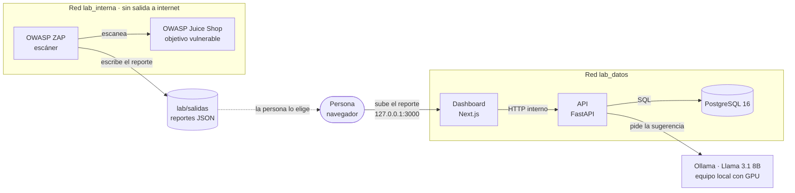

# SentinelAI

**Hallazgos de seguridad web priorizados con IA local**

Proyecto de Título · Capstone · Duoc UC · Grupo 3

[](https://github.com/monkedevluxo/capstone/actions/workflows/ci.yml)

---

## Qué es

Una plataforma web que centraliza los resultados de herramientas de análisis de seguridad ejecutadas sobre una aplicación deliberadamente vulnerable en un laboratorio aislado. Normaliza los hallazgos, los enriquece con un modelo de lenguaje ejecutado localmente y los presenta priorizados.

El flujo es: **escaneo → normalización → enriquecimiento con IA → validación humana → informe**.

### Qué hace la IA, y qué no

El modelo corre localmente con Ollama e **interpreta evidencia ya recolectada**. No escanea, no ataca y no descubre vulnerabilidades por sí mismo. Su trabajo es:

- **Explicar** el hallazgo técnico en lenguaje comprensible
- **Clasificar** según OWASP Top 10:2025 y sugerir una prioridad, con nivel de confianza
- **Recomendar** una medida de remediación concreta

Toda respuesta del modelo se valida contra un esquema antes de guardarse; si falla tres veces, el hallazgo queda marcado como no enriquecido. La validación final es siempre humana y queda registrada en la base de datos.

La calidad del modelo se mide contra un golden set etiquetado por una persona sin ver sus respuestas (`docs/evidencias/metricas_golden_set.md`). A partir de esas métricas, la propuesta del equipo es que la prioridad se asigne con una regla por severidad y que la categoría se contraste con una tabla CWE → OWASP (`docs/diseno/IA_MODELO_Y_PROMPT.md`, sección 5).

---

## Marco ético y legal

Las pruebas se ejecutan **únicamente** sobre aplicaciones vulnerables desplegadas en local, en una red sin exposición externa. Nunca se opera sobre infraestructura de terceros no autorizada.

La red del laboratorio usa `internal: true` en Docker, lo que significa que el contenedor objetivo **no tiene ruta de salida a internet**. No es una convención del equipo: es una restricción de infraestructura, verificable con los comandos de la sección de verificación.

La Ley 21.459 sobre delitos informáticos delimita el alcance del proyecto y justifica el uso exclusivo de entornos autorizados. La API rechaza importar reportes de hosts que no pertenezcan al laboratorio, y la base de datos rechaza registrar objetivos fuera de él.

---

## Arquitectura de la solución

SentinelAI son cinco servicios en Docker Compose, repartidos en dos redes que no se comunican entre sí, más el modelo de lenguaje, que corre fuera de Docker.



| Componente | Responsabilidad | Red |
|---|---|---|
| **Juice Shop** | Aplicación deliberadamente vulnerable: es el único objetivo de los escaneos | `lab_interna` |
| **OWASP ZAP** | Escanea el objetivo y escribe el reporte JSON en `lab/salidas/` | `lab_interna` |
| **API (FastAPI)** | Importa y normaliza los reportes, deduplica, consulta al modelo, registra las decisiones y genera el informe | `lab_datos` |
| **PostgreSQL** | Guarda objetivos, escaneos, hallazgos con su evidencia original, sugerencias de la IA y validaciones | `lab_datos` |
| **Dashboard (Next.js)** | Muestra los hallazgos y recibe las decisiones. Es lo único que usa la persona | `lab_datos` |
| **Ollama** | Ejecuta el modelo de lenguaje en un equipo propio. La API lo alcanza por la dirección configurada en `OLLAMA_URL` | Fuera de Docker |

**Cómo se comunican:**

- **El escáner y la plataforma no comparten red.** Lo único que pasa de un lado al otro es un archivo: ZAP escribe el reporte y una persona lo sube desde el dashboard. La red del objetivo es `internal: true`, sin ruta de salida.
- **El navegador solo habla con el dashboard.** El servidor de Next llama a la API dentro de `lab_datos`; la API no queda expuesta al navegador y no necesita CORS.
- **Todos los puertos se publican en `127.0.0.1`.** Nada queda accesible desde otros equipos de la red.
- **El modelo es opcional para operar.** Si Ollama no responde, la API contesta 503 y los hallazgos quedan "sin enriquecer"; el resto del flujo sigue funcionando.

El detalle del modelo de datos está en `docs/diseno/MODELO_DATOS.md` y el del hallazgo normalizado en `docs/diseno/ESQUEMA_HALLAZGO.md`.

---

## Estructura del repositorio

```
capstone/
├── .github/workflows/    CI: tests, migraciones y restricciones
├── backend/
│   ├── app/
│   │   ├── main.py           API FastAPI
│   │   ├── rutas.py          Endpoints de ingesta y consulta
│   │   ├── ingesta.py        Importación de reportes en una transacción
│   │   ├── models.py         Modelos SQLAlchemy (7 tablas)
│   │   ├── normalizacion.py  Rutas y claves de deduplicación
│   │   ├── parsers/          Conversión de salidas de escáneres
│   │   └── ia/               Cliente de Ollama, prompt, validación y reintentos
│   ├── migrations/           Migraciones de Alembic
│   ├── scripts/
│   │   ├── seed.py                 Datos de prueba sintéticos
│   │   ├── verificar_bd.py         Verifica las restricciones de la base
│   │   └── metricas_golden_set.py  Métricas del modelo contra el golden set
│   └── tests/                Parser, esquema, módulo de IA e ingesta
├── frontend/             Dashboard en Next.js (desde el S5)
├── lab/
│   ├── fixtures/         Escaneos congelados y versionados (insumo de desarrollo)
│   └── salidas/          Resultados de escaneos en curso (no se versiona)
├── docs/
│   ├── diseno/           Esquema del hallazgo, modelo de datos, IA y decisiones técnicas
│   ├── institucional/    Entregables formales que solicita Duoc UC (fase 1 y fase 2)
│   ├── guias/            Instalación, Docker, Ollama
│   └── evidencias/       Logs, mediciones, golden set y planillas de validación
├── docker-compose.yml
└── README.md
```

### Por qué `lab/fixtures/` sí se versiona

Un escaneo completo demora entre 9 y 40 minutos según el equipo y si usa Ajax Spider. Los fixtures son resultados reales congelados que permiten desarrollar y probar en segundos, sin levantar el laboratorio ni re-escanear. Es lo que hace reproducible el desarrollo del pipeline.

`lab/salidas/` no se versiona porque cambia en cada ejecución.

---

## Stack tecnológico

| Capa | Tecnología |
|---|---|
| Backend | Python · FastAPI · SQLAlchemy · Alembic |
| Base de datos | PostgreSQL 16 |
| IA | Ollama · Llama 3.1 8B (q4_K_M) · validación con Pydantic |
| Frontend | Next.js 16 (App Router) · React · TypeScript · Tailwind CSS · shadcn/ui · bun |
| Laboratorio | Docker Compose |
| Escáner | OWASP ZAP (con Ajax Spider) |
| Objetivo | OWASP Juice Shop |

Nikto, OpenVAS, DVWA y WebGoat quedaron fuera del alcance en la replanificación del 15-10-2026.

---

## Requisitos

- **Docker Engine** — no Docker Desktop, ver nota abajo
- Git
- **En Windows:** WSL2 con Ubuntu
- **Ollama** — solo en el equipo que actúe como nodo de inferencia

Instalación paso a paso: `docs/guias/GUIA_INSTALACION.md`

### Por qué Docker Engine y no Docker Desktop

Docker Desktop presentó inestabilidad bajo carga sostenida en uno de los equipos
del grupo: reinicios del motor, errores 500 en su API y escaneos interrumpidos a
mitad de ejecución. El diagnóstico apuntó a su capa de integración con WSL.
Migrar a Docker Engine nativo dentro de WSL2 resolvió el problema.

Docker Desktop puede funcionar en otros equipos, pero el camino soportado por el
equipo es Docker Engine.

---

## Cómo levantar el proyecto

```bash
git clone https://github.com/monkedevluxo/capstone.git
cd capstone
docker compose up -d
docker compose ps
```

Deben quedar corriendo `sentinel-juiceshop` y `sentinel-db`.

Juice Shop **no responde en `localhost:3000`**, y eso es correcto: vive dentro de `lab_interna` sin puertos publicados. Solo ZAP la alcanza.

### Verificar el aislamiento de red

```bash
# Dentro de lab_interna: debe fallar con "Network unreachable"
docker run --rm --network capstone_lab_interna alpine ping -c 2 -W 2 8.8.8.8

# En la red normal: debe responder
docker run --rm alpine ping -c 2 8.8.8.8
```

Si el nombre de la red no coincide, búsquenlo con `docker network ls`. Docker antepone el nombre de la carpeta del proyecto.

### Ejecutar un escaneo

```bash
# Rápido, solo análisis pasivo (1-2 minutos)
docker compose run --rm zap zap-baseline.py -t http://juiceshop:3000 -J baseline.json -I

# Completo, con escaneo activo (unos 9 minutos)
docker compose run --rm zap zap-full-scan.py -t http://juiceshop:3000 -J full.json -I

# Completo con Ajax Spider (más cobertura en Juice Shop; requiere más RAM)
docker compose run --rm zap zap-full-scan.py -t http://juiceshop:3000 -j -J ajax.json -I
```

Los resultados quedan en `lab/salidas/`.

**Si aparece `Permission denied` al escribir el JSON:** Docker creó `lab/salidas/` como root. Se corrige con `sudo chown -R $USER:$USER lab/salidas`.

### Levantar el backend y la base de datos

```bash
docker compose up -d db api
docker compose exec api alembic upgrade head
docker compose exec api python scripts/seed.py --reset
curl http://localhost:8000/stats
```

Debe devolver 1 objetivo, 2 escaneos y 40 hallazgos.

Los datos del seed son **sintéticos**, no vienen de un escaneo real. El objetivo
se llama "(datos de prueba)" justamente para no confundirlos en el informe.

### Importar un escaneo real

```bash
curl -X POST localhost:8000/scans/import \
  -H "Content-Type: application/json" \
  --data-binary @lab/fixtures/zap_juiceshop_ajax_v2.json

curl "localhost:8000/findings?severidad=alta"
```

| Endpoint | Qué hace |
|---|---|
| `POST /scans/import` | Importa un reporte de ZAP en una transacción. 403 si el host no es del laboratorio, 409 si el reporte ya se importó, 422 si no es un reporte de ZAP |
| `GET /scans` | Lista los escaneos importados, del más reciente al más antiguo, con su objetivo |
| `GET /findings` | Lista hallazgos con filtros por severidad, estado, escaneo, objetivo, categoría OWASP del modelo (`owasp`) o de la tabla CWE (`owasp_ref`), enriquecimiento, `revisar` y texto. Orden: severidad, después los marcados para revisar, después ocurrencias |
| `GET /findings/resumen` | Total y conteos por severidad, por estado, para revisar y sin enriquecer, con los mismos filtros que `GET /findings` |
| `GET /findings/{id}` | Detalle de un hallazgo, con la evidencia original, la capa de IA y las validaciones por separado |
| `POST /findings/{id}/enrich` | Enriquece un hallazgo con el modelo local y guarda el resultado con modelo, versión y hash del prompt. 503 si Ollama no responde |
| `POST /scans/{id}/enrich` | Enriquece uno por uno los hallazgos de un escaneo; por defecto se salta los que ya tienen un enriquecimiento válido |

Cada hallazgo del listado y del detalle trae `referencia`: la categoría OWASP según la tabla CWE → OWASP 2025, la prioridad por regla y la marca `requiere_revision` de la opción mixta. Se calcula al consultar; no se guarda.

Documentación interactiva de la API: `http://localhost:8000/docs`

### Levantar el dashboard

```bash
docker compose up -d web
```

Queda en `http://localhost:3000` y lista los hallazgos de `GET /findings`. El
servidor de Next lee la API en `http://api:8000` dentro de la red `lab_datos`;
el navegador nunca habla con la API directo, por eso no hay CORS. El servicio
`web` no está en `lab_interna`: no alcanza al objetivo.

El código de `frontend/` está montado en vivo y Next recarga al guardar. Si
cambian las dependencias (`package.json` o `bun.lock`), reconstruye y renueva
el volumen de `node_modules`:

```bash
docker compose up -d --build -V web
```

Para trabajar fuera del contenedor hace falta [bun](https://bun.sh). bun solo
instala y corre scripts; en el contenedor Next se ejecuta con Node:

```bash
cd frontend
bun install
bun --bun run lint        # --bun: usa el runtime de bun si no tienes Node
bun --bun run typecheck   # tsc de TypeScript 7
```

Las fuentes (IBM Plex) vienen empaquetadas, no de Google Fonts: el dashboard
compila y se ve igual sin internet.

<!-- TODO: documentar las variables de entorno y el archivo .env.ejemplo -->

---

## Presupuesto de memoria

Con 16 GB de RAM no conviene levantar todo simultáneamente. El pipeline es naturalmente por fases:

| Fase | Servicios | RAM aproximada |
|---|---|---|
| Escaneo | `juiceshop` + `zap` | ~9 GB |
| Enriquecimiento | `db` + `api` + Ollama | ~13 GB |
| Dashboard | `db` + `api` + `web` | ~8 GB |

---

## Documentación

| Documento | Ubicación |
|---|---|
| **Instalación del entorno** | `docs/guias/GUIA_INSTALACION.md` |
| Introducción a Docker | `docs/guias/DOCKER_BASICO.md` |
| Visión del producto | `docs/producto/PRODUCT_VISION.md` |
| Definición de terminado | `docs/producto/DEFINITION_OF_DONE.md` |
| Esquema del hallazgo normalizado | `docs/diseno/ESQUEMA_HALLAZGO.md` |
| Modelo de datos (DER y tablas) | `docs/diseno/MODELO_DATOS.md` |
| Modelo de IA, prompt y alternativas | `docs/diseno/IA_MODELO_Y_PROMPT.md` |
| Golden set y métricas del modelo | `docs/evidencias/metricas_golden_set.md` |
| Backend y migraciones (S2) | `docs/guias/GUIA_S2.md` |
| Ollama en equipo separado | `docs/guias/ADDENDUM_OLLAMA_REMOTO.md` |
| Entregables institucionales | `docs/institucional/` |
| Rol de Felipe | `docs/README_FELIPE.md` |
| Rol de Joaquín | `docs/README_JOAQUIN.md` |
| Planilla de sprints | `docs/SentinelAI_Plan_Sprints.xlsx` |

---

## Equipo

| Integrante | Rol | Responsabilidades |
|---|---|---|
| Felipe Cayún | Laboratorio y Validación | Escaneos, golden set, informe técnico exportable |
| Joaquín Herrera | Arquitectura, IA y Parser | Parser de ZAP, nodo de inferencia, prompt y métricas |
| Luciano Zambrano | Backend, Datos y Dashboard | Laboratorio, modelo de datos, API, CI y dashboard |

El detalle de cada rol está en `docs/README_FELIPE.md` y `docs/README_JOAQUIN.md`.

**Docente:** Aníbal Sotelo

---

## Metodología de trabajo

El equipo trabaja con una **metodología ágil e incremental basada en Scrum**, adaptada a un equipo de tres personas con horarios distintos.

| Elemento | Cómo lo aplicamos |
|---|---|
| **Sprints** | 7 sprints de 2 semanas, del 7 de septiembre al 13 de diciembre de 2026. Cada uno tiene un objetivo y un hito verificable |
| **Backlog** | 71 tareas en `docs/SentinelAI_Plan_Sprints.xlsx`, cada una con criterio de aceptación, responsable, estimación, dependencias y estado |
| **Definición de terminado** | `docs/producto/DEFINITION_OF_DONE.md`. Una tarea está terminada cuando su cambio está integrado en `main` |
| **Revisión** | Todo cambio entra por pull request, con la integración continua en verde y la aprobación de otro integrante |
| **Coordinación** | Asíncrona, por mensajería y en los propios pull requests, más la clase presencial de los viernes |
| **Riesgos** | Registro con probabilidad, impacto, mitigación y señal de alerta temprana, en la misma planilla |

Sobre esa base aplicamos cuatro prácticas de ingeniería:

- **Contrato de datos primero.** El esquema del hallazgo normalizado se definió antes de programar, para que cada integrante avanzara en paralelo.
- **Pruebas como especificación.** El comportamiento esperado se escribe como pruebas automáticas, que corren en cada pull request.
- **Fixtures versionados.** Los resultados reales de los escaneos se guardan en el repositorio, para desarrollar sin repetir escaneos de hasta 40 minutos.
- **Decisiones con datos.** Las decisiones sobre la IA se toman a partir de mediciones contra el golden set y quedan documentadas.

El plan original era de 9 sprints. El 15 de octubre se replanificó a 7, porque terminaba después del cierre del semestre. La visión del producto está en `docs/producto/PRODUCT_VISION.md`.

---

## Integración continua

Cada PR hacia `main` corre automáticamente en GitHub Actions
(`.github/workflows/ci.yml`). Son tres jobs:

| Job | Qué comprueba |
|---|---|
| **Tests** | Los tests del parser de ZAP, del módulo de IA (sin depender de Ollama) y que `ejemplo_hallazgo.json` cumpla `finding.schema.json` |
| **Migraciones y restricciones** | Que la migración aplique, se revierta y se reaplique sobre un PostgreSQL limpio; que modelos y migraciones estén sincronizados (`alembic check`); que la base rechace lo que debe rechazar; y los tests de ingesta y consulta contra la base real |
| **Frontend** | Que el dashboard pase ESLint, el chequeo de tipos con TypeScript 7 y `next build` |

En total son 149 pruebas automatizadas, más las verificaciones de restricciones.

Las restricciones que se verifican en cada PR:

- solo se aceptan objetivos del laboratorio (Ley 21.459)
- un enriquecimiento fallido no puede traer datos a medias
- un hallazgo no puede tener dos enriquecimientos vigentes
- la confianza del modelo va entre 0 y 1
- no se puede duplicar un hallazgo en el mismo objetivo

La restricción ética del proyecto no depende de que alguien se acuerde de
respetarla: si un cambio la debilita, el CI falla y el PR no se puede mergear.

**No hay CD.** El sistema es deliberadamente local, así que no hay dónde
desplegar. Los escaneos de ZAP y la inferencia con Ollama tampoco corren en el
CI: uno es lento y el otro necesita GPU. Siguen siendo manuales.

### Correr las mismas verificaciones en local

```bash
cd backend
pip install -r requirements-dev.txt
python -m pytest tests/ -v
docker compose exec api python scripts/verificar_bd.py
```

`verificar_bd.py` espera los 40 hallazgos del seed. Si tu base tiene otros
datos, recárgala antes con `docker compose exec api python scripts/seed.py --reset`.

Los tests de ingesta, enriquecimiento y resumen (`tests/test_ingesta.py`, `tests/test_enriquecimiento_api.py`, `tests/test_resumen_filtros_api.py`) se saltan si no hay una base
PostgreSQL disponible, y vacían las tablas antes de cada prueba: no los corras
contra una base con datos que quieras conservar.

---

## Convenciones de trabajo

**Ramas:** `persona/tema`. Por ejemplo `luciano/backend-base`, `joaquin/parser-zap`,
`felipe/lab-escaneos`.

**Commits:** formato `tipo: descripción` — `feat`, `fix`, `docs`, `test`, `lab`, `chore`

**Pull requests:** `main` está protegida. Todo cambio entra por PR, con los dos
checks del CI en verde y una aprobación de otro integrante. Nadie aprueba su
propio PR: la revisión también sirve para que los tres conozcan el código que
van a defender.

---

## Estado del proyecto

El plan parte el 7 de septiembre de 2026 y termina el 13 de diciembre, dentro del semestre. Originalmente eran 9 sprints de 2 semanas; el 15 de octubre se replanificó a 7 porque el plan original terminaba en enero, después del cierre del semestre.

- [x] **S1 · 7 sep – 20 sep** — Laboratorio, aislamiento de red, primer escaneo
- [x] **S2 · 21 sep – 4 oct** — Modelo de datos y migraciones
- [x] **S3 · 5 oct – 18 oct** — Parser, normalización y API de ingesta
- [ ] **S4 · 19 oct – 1 nov** — IA integrada a la API y enriquecimiento por lote *(módulo de IA ya adelantado)*
- [ ] **S5 · 2 nov – 15 nov** — Golden set completo y dashboard *(golden set inicial ya adelantado)*
- [ ] **S6 · 16 nov – 29 nov** — Validación humana, informe técnico y congelamiento (tercera entrega)
- [ ] **S7 · 30 nov – 13 dic** — Documentación, evidencias y defensa

El detalle de las 71 tareas, con su estado y responsable, está en la planilla de sprints.
