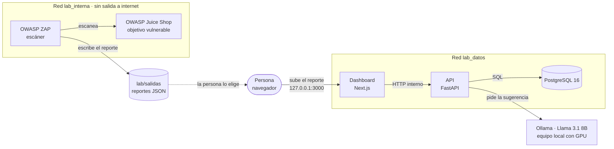
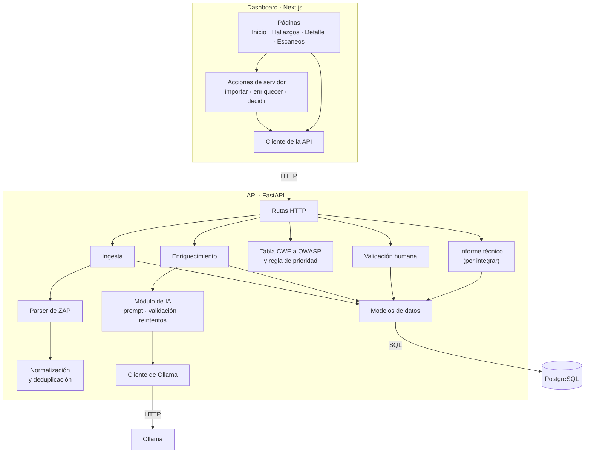
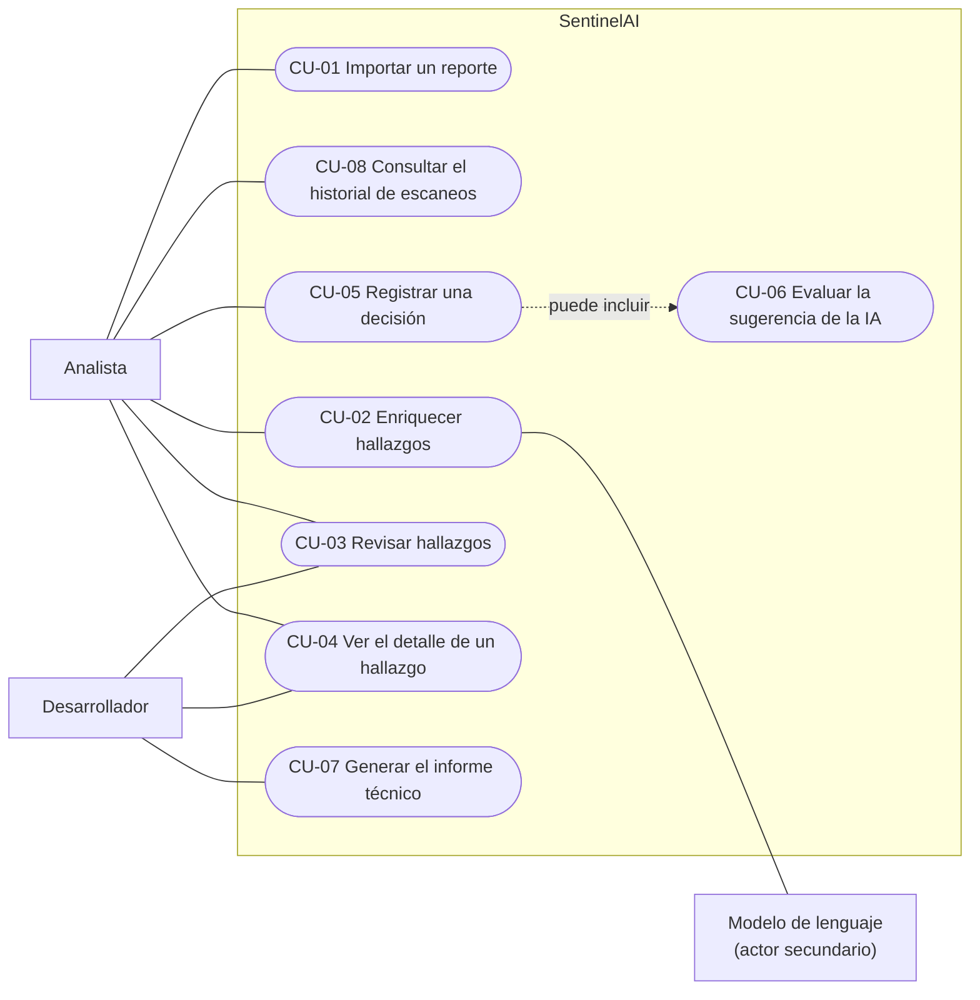
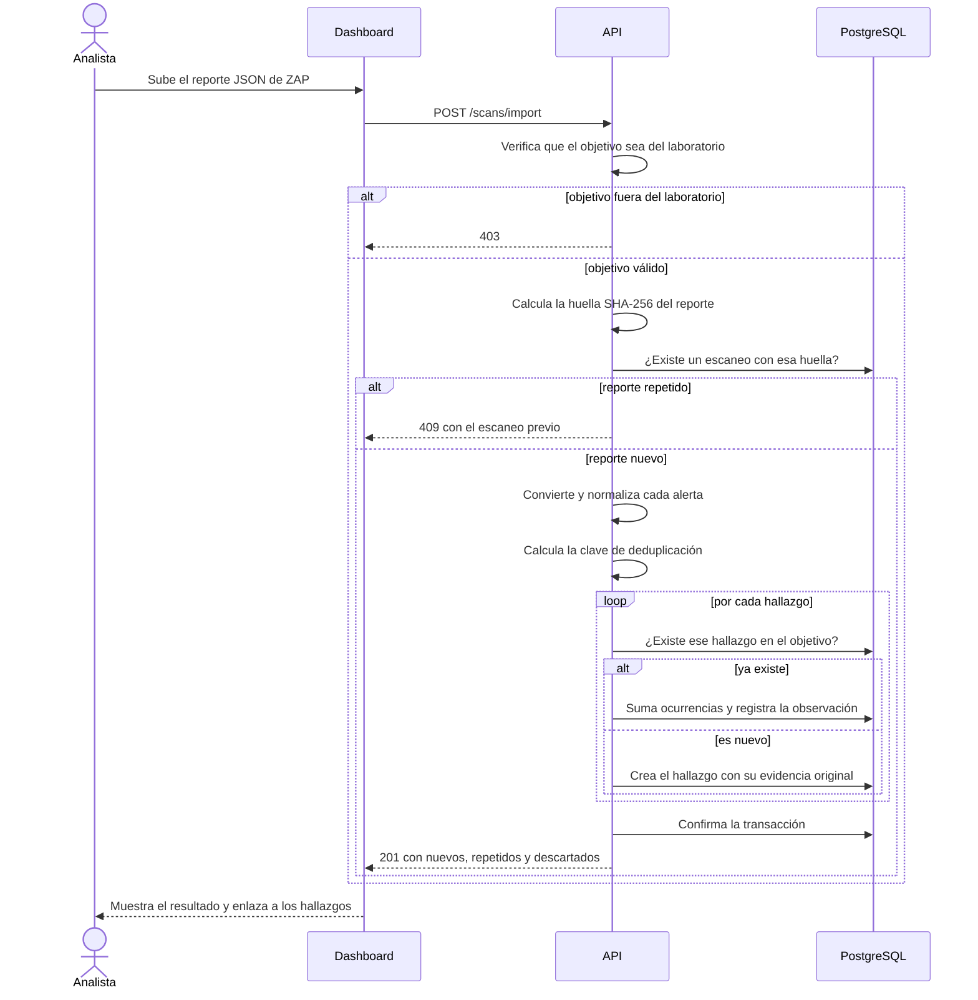
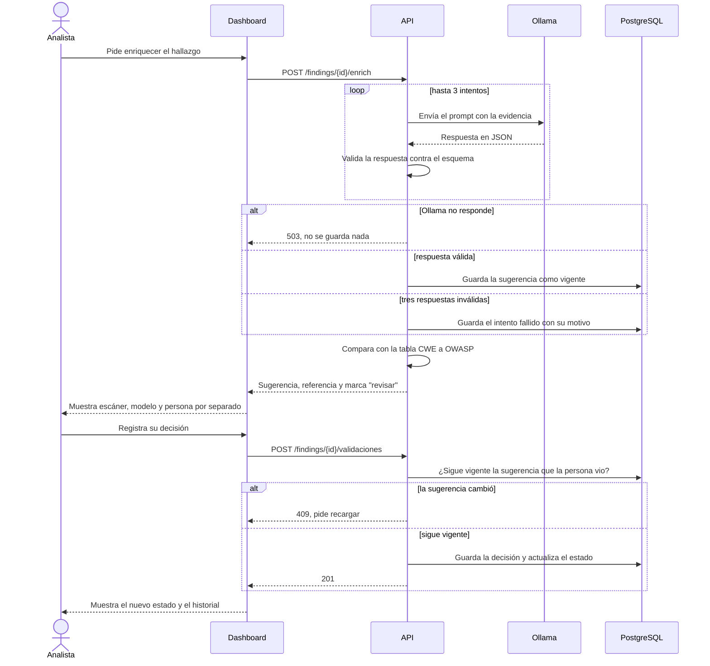
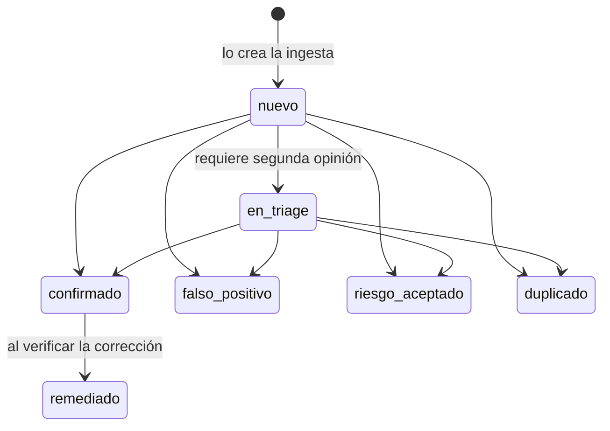
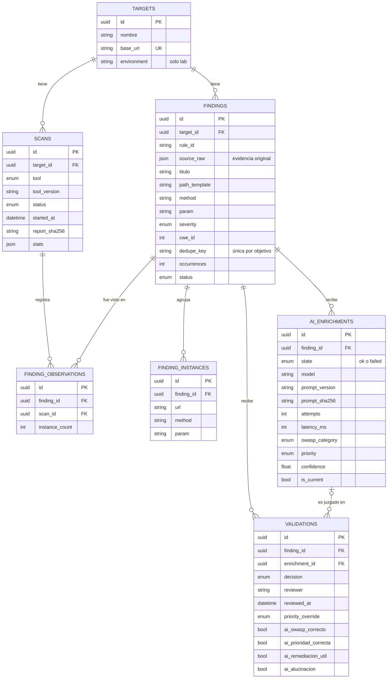
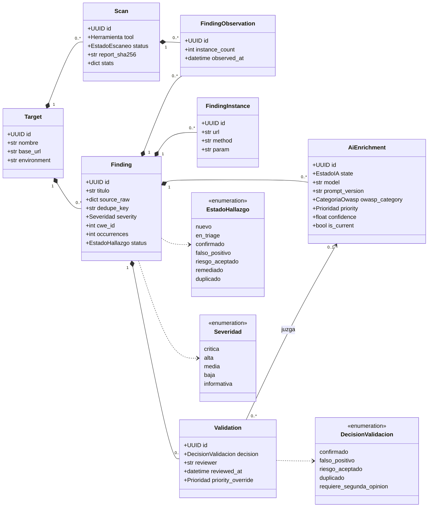

# Documento de diseño

**SentinelAI** · Proyecto de Título · Capstone · Duoc UC · Grupo 3 · Actualizado: 16-11-2026

Este documento reúne el diseño del sistema: arquitectura, componentes, casos de uso, secuencias, modelo de datos, decisiones técnicas y despliegue. Resume y enlaza los documentos de detalle; no los reemplaza.

| Para profundizar en | Ver |
|---|---|
| El hallazgo normalizado y sus cuatro capas | `docs/diseno/ESQUEMA_HALLAZGO.md` |
| Tablas, índices y restricciones | `docs/diseno/MODELO_DATOS.md` |
| Modelo de lenguaje, prompt y validación | `docs/diseno/IA_MODELO_Y_PROMPT.md` |
| Problema, usuarios y alcance | `docs/producto/PRODUCT_VISION.md` |

**Alcance de este documento.** Describe el sistema completo que el equipo va a defender. Al 16-11-2026, cuatro partes están implementadas pero todavía no se integran a la rama `main`: el detalle del hallazgo con el registro de la decisión humana (pull request #28), el informe técnico (pull request #22), el intercambio de anotaciones entre equipos y la página de escaneos. Se indican como *por integrar* donde aparecen.

---

## 1. Arquitectura

SentinelAI son cinco servicios en Docker Compose, repartidos en dos redes que no se comunican entre sí, más el modelo de lenguaje, que corre fuera de Docker.

**Estilo.** Es una arquitectura de tres capas (presentación, lógica y datos) con dos servicios auxiliares: el laboratorio de escaneo, que queda aislado, y el modelo de lenguaje, que es externo y opcional.

**Principios que la ordenan:**

1. **El escáner y la plataforma no comparten red.** Entre ambos solo pasa un archivo. El objetivo vulnerable no puede alcanzar la base de datos, la API ni internet.
2. **El navegador solo habla con el dashboard.** El servidor de Next llama a la API dentro de la red interna, así que la API no queda expuesta y no necesita CORS.
3. **La IA es un servicio que puede faltar.** Si el modelo no responde, el sistema sigue operando y los hallazgos quedan "sin enriquecer".
4. **Cuatro capas de información que nunca se sobrescriben:** lo que dijo la herramienta, lo que normalizó el sistema, lo que interpretó la IA y lo que decidió una persona.

---

## 2. Componentes

### Backend

| Componente | Archivo | Responsabilidad |
|---|---|---|
| Rutas HTTP | `backend/app/rutas.py`, `main.py` | Expone los endpoints, valida la entrada y traduce los errores a códigos HTTP |
| Ingesta | `backend/app/ingesta.py` | Importa un reporte en una sola transacción: verifica el objetivo, calcula la huella del reporte y crea o actualiza los hallazgos |
| Parser de ZAP | `backend/app/parsers/zap.py` | Convierte las alertas del reporte al esquema normalizado |
| Normalización | `backend/app/normalizacion.py` | Normaliza las rutas, unifica la severidad y calcula la clave de deduplicación |
| Enriquecimiento | `backend/app/enriquecimiento.py` | Pide la sugerencia al modelo, la guarda con su trazabilidad y mantiene una sola sugerencia vigente por hallazgo |
| Módulo de IA | `backend/app/ia/` | Arma el prompt, valida la respuesta contra el esquema y reintenta hasta tres veces |
| Cliente de Ollama | `backend/app/ia/cliente.py` | Llama al modelo con tiempo límite y distingue "modelo apagado" de "respuesta inválida" |
| Tabla CWE a OWASP | `backend/app/ia/owasp_por_cwe.py` | Entrega la categoría de referencia, la prioridad por regla y la marca "revisar" |
| Validación humana | `backend/app/validacion.py` | Fija el estado del hallazgo según la decisión más reciente *(por integrar)* |
| Intercambio | `backend/app/intercambio.py` | Exporta e importa sugerencias y decisiones entre bases, y calcula las métricas *(por integrar)* |
| Informe técnico | `backend/app/informe.py` | Arma el informe exportable en HTML *(por integrar)* |
| Modelos de datos | `backend/app/models.py` | Las siete tablas y sus restricciones |

### Dashboard

| Componente | Ubicación | Responsabilidad |
|---|---|---|
| Páginas | `frontend/src/app/` | Inicio (importar), Hallazgos (lista con totales y filtros), Detalle (tres capas) y Escaneos (historial). Las dos últimas están por integrar |
| Acciones de servidor | `frontend/src/app/acciones.ts` | Importar un reporte, enriquecer y registrar una decisión. Se ejecutan en el servidor de Next |
| Cliente de la API | `frontend/src/lib/api.ts` | Único punto que llama a la API; la dirección no llega al navegador |
| Filtros | `frontend/src/lib/filtros.ts` | Guarda el estado de los filtros en la dirección de la página y lo valida |
| Componentes de pantalla | `frontend/src/components/` | Totales, tabla, filtros, capas del detalle y formulario de decisión |

---

## 3. Casos de uso

Mermaid no tiene un tipo de diagrama de casos de uso; se representa con actores a los lados y los casos como óvalos.

| Caso de uso | Actor | Resultado | Historias |
|---|---|---|---|
| CU-01 Importar un reporte | Analista | Los hallazgos del reporte quedan normalizados y sin duplicados | HU-03 a HU-07 |
| CU-02 Enriquecer hallazgos | Analista, modelo | Cada hallazgo recibe una sugerencia validada, o queda "sin enriquecer" | HU-08 a HU-12 |
| CU-03 Revisar hallazgos | Analista, desarrollador | Lista priorizada, con filtros y con los casos dudosos primero | HU-13 a HU-15 |
| CU-04 Ver el detalle | Analista, desarrollador | Evidencia, sugerencia y decisiones, separadas por capa | HU-16 |
| CU-05 Registrar una decisión | Analista | La decisión queda con nombre y fecha, y cambia el estado del hallazgo | HU-18 a HU-20 |
| CU-06 Evaluar la sugerencia | Analista | Respuestas que alimentan las métricas de calidad de la IA | HU-23 a HU-25 |
| CU-07 Generar el informe | Desarrollador | Informe exportable con los hallazgos priorizados | HU-21, HU-22 |
| CU-08 Consultar los escaneos | Analista | Historial de reportes importados y su avance | HU-17 |

Las historias están en `docs/producto/PRODUCT_BACKLOG.md`.

---

## 4. Secuencia de la funcionalidad principal

La funcionalidad principal es el flujo **reporte → hallazgo → sugerencia → decisión**. Se muestra en dos diagramas.

### 4.1 Importar un reporte

Todo ocurre en una transacción: si algo falla a la mitad, no queda un escaneo importado a medias.

### 4.2 Enriquecer y decidir

Dos reglas de este flujo:

- **Un intento fallido no reemplaza una sugerencia válida anterior.** Se guarda como historial.
- **La decisión se asocia a la sugerencia exacta que se juzgó.** Si alguien volvió a enriquecer mientras la persona decidía, la API lo rechaza para que no se evalúe un texto distinto al que se leyó.

### 4.3 Ciclo de vida del hallazgo

Toda transición, salvo la primera, exige una decisión humana registrada. El estado lo fija la decisión más reciente, así que una persona puede corregir una decisión anterior. `remediado` existe en el modelo, pero su verificación automática queda como trabajo futuro.

---

## 5. Modelo de datos

Base relacional en PostgreSQL 16, con siete tablas.

El diagrama muestra los campos principales; la lista completa está en `docs/diseno/MODELO_DATOS.md`.

**Decisiones del modelo:**

- **Un hallazgo pertenece al objetivo, no al escaneo.** La unicidad es `(target_id, dedupe_key)`. Volver a escanear no crea hallazgos nuevos: agrega una observación. Así se puede decir cuántos escaneos lleva abierto un problema.
- **Las sugerencias y las decisiones son históricas.** Nunca se sobrescriben. De las sugerencias de un hallazgo, una sola es la vigente.
- **Las reglas del proyecto son restricciones de la base.** Por ejemplo, un objetivo solo puede ser del laboratorio, y una sugerencia fallida no puede traer campos rellenados a medias.
- **Los enumerados son tipos nativos de PostgreSQL.** Agregar un valor exige una migración, lo que obliga a decidirlo.

### Diagrama de clases

Las clases de dominio son los modelos de `backend/app/models.py`, uno por tabla, más sus enumerados.

---

## 6. Decisiones técnicas

| # | Decisión | Alternativa descartada | Motivo |
|---|---|---|---|
| D-01 | Modelo de lenguaje local con Ollama | Un servicio de IA en la nube | Los hallazgos de seguridad son información sensible y no deben salir del equipo. Además permite operar sin internet |
| D-02 | Llama 3.1 de 8 mil millones de parámetros, cuantizado | Modelos más grandes | Debe correr en el hardware de un estudiante. La latencia se midió antes de comprometer la arquitectura (`docs/evidencias/latencia_ollama.md`) |
| D-03 | La IA solo interpreta evidencia existente | Que la IA escanee o descubra vulnerabilidades | Acota el riesgo y hace verificable su trabajo: toda sugerencia se contrasta con la evidencia |
| D-04 | Validar la salida del modelo contra un esquema, con hasta tres intentos | Guardar la respuesta tal como llega | Un modelo puede devolver texto inválido. Lo que no pasa la validación queda "sin enriquecer" |
| D-05 | Opción mixta: prioridad por regla fija y categoría contrastada con la tabla CWE → OWASP | Usar la prioridad y la categoría del modelo | Las mediciones mostraron que la regla acierta más que el modelo en prioridad, y que el modelo declara la misma confianza cuando se equivoca (`docs/diseno/IA_MODELO_Y_PROMPT.md`, sección 5) |
| D-06 | La decisión final es siempre humana y queda registrada | Aplicar la sugerencia de la IA automáticamente | Es el principio central del proyecto. El estado de un hallazgo solo cambia con una validación con autor y fecha |
| D-07 | El hallazgo pertenece al objetivo, con clave de deduplicación | Que cada escaneo cree sus propios hallazgos | Permite seguir un problema entre escaneos y evita duplicados |
| D-08 | Dos redes Docker separadas; el objetivo en una red sin salida | Una sola red para todo | El aislamiento es una restricción de infraestructura verificable, no una convención |
| D-09 | Enriquecimiento por lote síncrono, con guardado por hallazgo | Una cola de trabajos en segundo plano | Con el modelo cargado, cada hallazgo toma entre uno y dos segundos. La cola agregaba complejidad sin beneficio a esta escala. Se eliminaron las tareas T-036 y T-037 |
| D-10 | El dashboard llama a la API desde el servidor de Next | Llamar a la API desde el navegador | La API no se expone, no hace falta CORS y la dirección interna no llega al navegador |
| D-11 | Estado "duplicado" propio | Marcar los duplicados como falsos positivos | Un duplicado es un problema real ya reportado; mezclarlos distorsiona la métrica de falsos positivos |
| D-12 | Sin cuentas de usuario; el revisor escribe su nombre | Autenticación con usuarios y permisos | El sistema opera en un laboratorio local. Queda como trabajo futuro |
| D-13 | Fixtures de escaneos versionados en el repositorio | Escanear cada vez que se prueba | Un escaneo toma de 9 a 40 minutos. Con fixtures, las pruebas corren en segundos y son reproducibles |
| D-14 | Solo OWASP ZAP como escáner | Integrar también Nikto y OpenVAS | Se redujo el alcance en la replanificación del 15-10-2026. El modelo de datos admite otras herramientas |

**Limitación conocida de D-07.** La clave de deduplicación incluye la ruta normalizada. Un mismo tipo de alerta visto en rutas distintas genera hallazgos distintos, y algunos son en la práctica el mismo problema. Lo cubre la decisión D-11: una persona puede marcarlos como duplicados.

---

## 7. Diseño de despliegue con Docker

Todo el sistema se define en `docker-compose.yml`.

| Servicio | Imagen | Red | Puerto publicado | Datos |
|---|---|---|---|---|
| `juiceshop` | `bkimminich/juice-shop` | `lab_interna` | Ninguno | Sin estado |
| `zap` | `zaproxy/zap-stable` | `lab_interna` | Ninguno | Escribe en `lab/salidas/`. Solo se levanta para escanear (perfil `scan`) |
| `db` | `postgres:16-alpine` | `lab_datos` | `127.0.0.1:5432` | Volumen `pgdata` |
| `api` | Construida desde `backend/Dockerfile` (Python 3.12) | `lab_datos` | `127.0.0.1:8000` | Sin estado propio |
| `web` | Construida desde `frontend/Dockerfile` (Node 24) | `lab_datos` | `127.0.0.1:3000` | Sin estado propio |

- **Redes:** `lab_interna` se declara con `internal: true`, sin ruta de salida. `lab_datos` es la red de la plataforma.
- **Puertos:** todos se publican solo en `127.0.0.1`; nada queda accesible desde otros equipos.
- **Usuario sin privilegios:** la imagen de la API corre con un usuario propio, no como `root`.
- **Orden de arranque:** la API espera a que la base responda, y el dashboard a que la API esté sana, mediante comprobaciones de salud.
- **Ollama** corre fuera de Docker, en el mismo equipo o en otro de la red local. La API lo alcanza por la dirección de la variable `OLLAMA_URL`.

**Variables de entorno principales:**

| Variable | Servicio | Para qué sirve |
|---|---|---|
| `DATABASE_URL` | `api` | Conexión a PostgreSQL |
| `OLLAMA_URL` | `api` | Dirección del modelo de lenguaje |
| `OLLAMA_MODEL` | `api` | Modelo a usar |
| `OLLAMA_TIMEOUT_S` | `api` | Tiempo límite de cada llamada al modelo |
| `LAB_HOSTS` | `api` | Equipos del laboratorio; la ingesta rechaza cualquier otro |
| `API_URL` | `web` | Dirección de la API, leída solo por el servidor de Next |

Las instrucciones para levantar el sistema están en el `README.md`.
